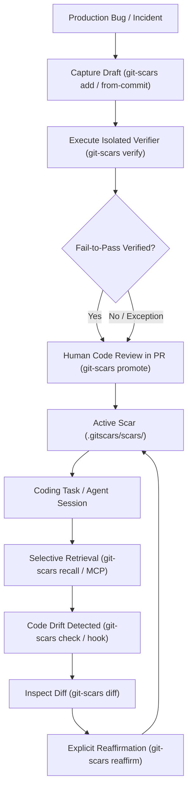

# GitScars (`git-scars`)

[](https://pkg.go.dev/github.com/Pavanspoojary/scars)
[](LICENSE)
[](https://goreportcard.com/report/github.com/Pavanspoojary/scars)
[](https://github.com/Pavanspoojary/scars/actions/workflows/ci.yml)

> **A Git-native failure memory and regression guardrail system for software engineers and AI coding assistants.**

GitScars captures lessons learned from production incidents, subtle concurrency bugs, and breaking regressions as versioned, human-reviewable Markdown documents anchored directly to repository files, symbols, error signatures, and dependency versions.

When developers edit code or coding agents (Claude Code, Cursor, Antigravity, Windsurf) tackle tasks, GitScars deterministically retrieves only the relevant failure memories before mistakes repeat.

---

## Table of Contents

- [The Problem](#the-problem)
- [Architecture & Comparison](#architecture--comparison)
- [How It Works](#how-it-works)
- [Installation & Build](#installation--build)
- [Quickstart Workflow](#quickstart-workflow)
- [File Format & Schema](#file-format--schema)
- [AI Agent Integration & MCP Server](#ai-agent-integration--mcp-server)
- [Dependency Manifest & Lockfile Anchors](#dependency-manifest--lockfile-anchors)
- [CLI Command Reference](#cli-command-reference)
- [Security, Isolation & Privacy](#security-isolation--privacy)
- [Documentation & ADRs](#documentation--adrs)
- [Contributing](#contributing)

---

## The Problem

Repository knowledge frequently disappears into old commits, closed pull requests, Slack threads, and transient agent conversation transcripts. As repositories expand:

- **Monolithic Instruction Files (`AGENTS.md`, `CLAUDE.md`)** suffer from prompt bloat, attention dilution ("lost in the middle"), and cannot bind rules to specific file versions or symbol anchors.
- **Vector Memory & RAG** introduce semantic hallucinations, noisy false-positive retrieval (see [VibeMemBench arXiv:2609.23570](https://arxiv.org/abs/2609.23570)), and vulnerability to indirect prompt injection ([MemSecBench arXiv:2607.27080](https://arxiv.org/abs/2607.27080)).
- **Silent Code Drift**: Code changes over time. When files change, lessons written months ago become stale or invalid, but flat files provide no way to detect staleness.

---

## Architecture & Comparison

| Capability | Flat Rules (`AGENTS.md`) | Vector Memory (RAG) | Git History / PRs | **GitScars (`git-scars`)** |
| :--- | :--- | :--- | :--- | :--- |
| **Context Overhead** | Linear prompt bloat | Retrieval tokens + vector DB | Manual inspection | $\le 3$ relevant Scars (or clean abstention) |
| **Retrieval Precision** | None (loaded into all prompts) | Low (semantic hallucination) | Manual search | Deterministic multi-signal anchor scoring |
| **Freshness Detection** | None (silent obsolescence) | None | None | Dynamic SHA-256 baseline hashing |
| **Verification Evidence**| Unverified claims | None | Ad-hoc CI logs | Isolated fail-to-pass overlay test |
| **Human Governance** | Ad-hoc | None | PR code review | Decoupled review state + CODEOWNERS |
| **Runtime Dependencies**| Offline | Remote embeddings / DB | Local Git | **Zero dependencies (pure Go single binary)** |

---

## How It Works



---

## Installation & Build

Requires Go 1.22+:

```bash
# Clone the repository
git clone https://github.com/Pavanspoojary/scars.git
cd scars

# Build the single standalone static binary
go build -o git-scars ./cmd/git-scars
```

Optionally install `git-scars` into your system `$PATH`:
```bash
sudo mv git-scars /usr/local/bin/
```
Once installed, Git automatically discovers it: you can run either `git-scars <command>` or `git scars <command>`.

---

## Quickstart Workflow

### 1. Initialize GitScars
```bash
git-scars init
```
Creates `.gitscars/scars/` for versioned lessons and `.gitscars/.local/` (automatically gitignored) for derived local state (indexes, trusted verifier hashes, feedback).

### 2. Capture a Failure Lesson
Create a new draft manually:
```bash
git-scars add \
  --title "Nil pointer dereference in auth context" \
  --lesson "Always use comma-ok idiom when reading user profile from request context" \
  --files "pkg/auth/context.go"
```

Or capture automatically from an existing fix commit without requiring an LLM:
```bash
git-scars add from-commit 8a1b3f9
```
*Prefills changed files, parent base commit, fix commit, and inferred test commands into a new draft.*

### 3. Record Verification Evidence
Execute the verifier safely against the codebase:
```bash
git-scars verify nil-pointer-dereference-8a1b3f --interactive
```
Computes deterministic command hashes, scrubs the environment, redacts secrets, and tests the worktree.

### 4. Review and Promote
Human review is required before a Scar can become active:
```bash
git-scars promote nil-pointer-dereference-8a1b3f \
  --status active \
  --reviewer "alice" \
  --rationale "Reviewed test reproduction in PR #42"
```

### 5. Selective Retrieval
Retrieve relevant lessons during coding tasks:
```bash
# By target file
git-scars recall --files pkg/auth/context.go

# Diff-aware retrieval (against a branch or commit)
git-scars recall --diff origin/main

# Failure-aware retrieval from failing test stderr
go test ./... 2>&1 | git-scars recall --stdin

# Machine-readable JSON output for coding agents
git-scars recall --files pkg/auth/context.go --json
```

### 6. Read-Only Freshness Check in CI
Add to your CI workflow to ensure no active Scars have stale anchors:
```bash
git-scars check
```
**Stable Exit Codes**:
- `0`: All Scars valid and current.
- `1`: Invalid format or invariant violation.
- `2`: Stale anchor detected (code modified since baseline, requires reaffirmation).
- `3`: Operational error.

### 7. Git Pre-Commit Hook Guardrail
Install the Git pre-commit hook to catch stale active scars before staging and committing:
```bash
# Install hook into .git/hooks/pre-commit
git-scars hook install

# Inspect hook status
git-scars hook status

# Uninstall hook
git-scars hook uninstall
```

### 8. Inspect Drift & Reaffirm
When `git-scars check` or pre-commit hooks report modified anchors, inspect the exact unified diff before reaffirming:
```bash
# View unified line diff against recorded anchor baseline
git-scars diff map-write-crash-391945

# Reaffirm anchor baseline after human review
git-scars reaffirm map-write-crash-391945 \
  --reviewer "alice" \
  --rationale "Verified logic holds after refactoring exporter package"
```

### 9. Repository Health & Metrics
Inspect overall repository scar metrics, monitored anchors, and recorded feedback:
```bash
# Human-readable summary
git-scars stats

# Machine-readable JSON metrics
git-scars stats --json
```

---

## File Format & Schema

Each Scar is stored as a single, human-readable, Git-diffable Markdown file in `.gitscars/scars/<slug>-<shortid>.md` with strict YAML frontmatter:

```markdown
---
schema_version: "1"
id: "map-write-crash-391945"
slug: "concurrent-map-write-in-telemetry-exporter"
title: "Concurrent map write in telemetry exporter"
lesson: "Metrics map must be protected by sync.RWMutex during RecordMetric calls."
applicability: "Telemetry exporters handling concurrent metrics emissions."
anchors:
  files:
    - "pkg/telemetry/exporter.go"
  symbols:
    - "RecordMetric"
  commands:
    - "go test -race ./pkg/telemetry/..."
  error_signatures:
    - "fatal error: concurrent map writes"
verifier:
  result: "fail_to_pass"
  argv:
    - "go"
    - "test"
    - "-race"
    - "./pkg/telemetry/..."
  command_hash: "2d4b1ee683d6be106b1633c27fedb692d3f757a5aa049397e28ef1cbd6d52736"
baseline:
  recorded_at: "2026-10-11T08:00:00Z"
  pkg/telemetry/exporter.go: "a3b98f12c4..."
review:
  status: "approved"
  reviewer: "bob"
  date: "2026-10-11T08:05:00Z"
  rationale: "Reproduced with race detector in PR #104"
lifecycle:
  state: "active"
---

### Symptom & Root Cause
Under heavy concurrent load, multiple goroutines called RecordMetric simultaneously without synchronization.

### Footgun / Guardrail
Replaced raw map with sync.Map or guarded reads and writes with sync.RWMutex.
```

---

## AI Agent Integration & MCP Server

### 1. Model Context Protocol (MCP) Server

GitScars provides a built-in stdio Model Context Protocol (MCP) server for native integration with coding assistants:

```bash
git-scars mcp
```

The MCP server exposes three read-only tools:
- `list_scars`: List all repository scars with their lifecycle and dynamic freshness status.
- `get_scar`: Retrieve full frontmatter, anchors, verifier results, and markdown body by scar ID.
- `recall_scars`: Deterministically retrieve matching scars for target files, symbols, error messages, and commands.

#### Client Configuration

##### Claude Desktop (`claude_desktop_config.json`) / Cursor (`.cursor/mcp.json`) / Antigravity
```json
{
  "mcpServers": {
    "git-scars": {
      "command": "git-scars",
      "args": ["mcp"]
    }
  }
}
```

##### Zed (`settings.json`)
```json
{
  "context_servers": [
    {
      "id": "git-scars",
      "command": {
        "path": "git-scars",
        "args": ["mcp"]
      }
    }
  ]
}
```

### 2. CLI JSON Recall (`reposcars.recall.v1`)

Agents can also invoke the CLI directly:
```bash
git scars recall --files "$MODIFIED_FILES" --json
```

Output:
```json
{
  "schema_version": "reposcars.recall.v1",
  "timestamp": "2026-10-11T08:00:00Z",
  "query": { "files": ["pkg/telemetry/exporter.go"], "threshold": 3, "top_k": 3 },
  "count": 1,
  "results": [
    {
      "id": "map-write-crash-391945",
      "title": "Concurrent map write in telemetry exporter",
      "lesson": "Metrics map must be protected by sync.RWMutex during RecordMetric calls.",
      "score": 5,
      "freshness": "current",
      "matches": ["file(+5)"],
      "explanation": "file(+5)",
      "anchors": { "files": ["pkg/telemetry/exporter.go"] }
    }
  ]
}
```

---

## Dependency Manifest & Lockfile Anchors

GitScars automatically inspects repository dependency manifests and lockfiles to anchor lessons to exact package versions without manual configuration:

- **Go**: Direct module dependencies and versions from `go.mod`.
- **Node.js**: Package dependencies and versions from `package-lock.json` (v1, v2, and v3).
- **Rust**: Package versions from `Cargo.lock`.
- **Python**: Dependencies and versions from `poetry.lock` and `requirements.txt`.

When dependencies are upgraded or downgraded, Scars anchored to vulnerable or breaking versions automatically trigger match signals during recall.

---

## CLI Command Reference

| Command | Arguments | Description |
| :--- | :--- | :--- |
| `init` | none | Initialize `.gitscars/` repository metadata and default config |
| `add` | `--title`, `--lesson`, `--files` | Create a new scar draft |
| `add from-commit` | `<sha>` | Automatically prefill a draft from a Git commit diff |
| `list` | none | List recorded scars with lifecycle, review, and freshness |
| `show` | `<id>` | Display full metadata, anchors, and body of a scar |
| `diff` | `<id>` | Inspect unified line diff of anchor files against baseline |
| `promote` | `<id> --status active` | Promote a scar to active state (enforces review & verifier invariants) |
| `verify` | `<id> [--interactive]` | Safely execute verifier in scrubbed env and record evidence |
| `reaffirm` | `<id> --reviewer --rationale` | Reaffirm a scar after anchor code drift |
| `retire` | `<id>` | Retire a scar that is no longer applicable |
| `recall` | `--files`, `--diff`, `--stdin`, `--json` | Retrieve relevant scars with deterministic multi-signal scoring |
| `check` | `[--diff <ref>]` | Read-only verification of scar freshness and invariants |
| `lint` | none | Security and schema audit (checks traversal, injections, duplicate titles) |
| `stats` | `[--json]` | Display repository metrics, monitored anchors, and feedback stats |
| `index` | none | Rebuild `.gitscars/.local/index.json` fast cache |
| `hook` | `install`, `status`, `uninstall` | Manage Git pre-commit hook guardrail |
| `mcp` | none | Run read-only stdio Model Context Protocol (MCP) server |
| `feedback` | `<id> --rating --notes` | Record retrieval utility feedback (`helpful`, `irrelevant`, `incorrect`) |
| `version` | none | Print `git-scars` version |

---

## Security, Isolation & Privacy

- **Untrusted Content**: Scars are treated as untrusted data, never privileged agent instructions.
- **Argv Execution**: Verifiers are represented as `argv` arrays and executed without shell interpolation by default.
- **Environment Scrubbing**: Only an allowlisted set of environment variables (`PATH`, `HOME`, `LANG`, `TMPDIR`, `USER`) are passed into verifier processes.
- **Secret Redaction**: Automated regex scrubbing redacts Bearer tokens, private keys, and passwords before recording excerpts.
- **Zero Cloud Telemetry**: All feedback, index caches, and command trust lists are stored locally in gitignored `.gitscars/.local/`.

---

## Documentation & ADRs

- [PRIOR_ART.md](PRIOR_ART.md): Primary-source comparative analysis (`Daily-Nerd/Scar`, `fscars`, `gitmem`, arXiv:2609.23570).
- [EVAL_PLAN.md](EVAL_PLAN.md): Preregistered benchmark evaluation plan, scoring baseline weights, and power calculations.
- [DECISIONS.md](DECISIONS.md): Architecture Decision Records (ADR-0001 through ADR-0007).

---

## Contributing

Contributions are welcome! Please read [CONTRIBUTING.md](CONTRIBUTING.md) and [AGENTS.md](AGENTS.md) for repository standards, code quality gates, and branching rules.

---

## License

Apache License 2.0. See [LICENSE](LICENSE) for details.
