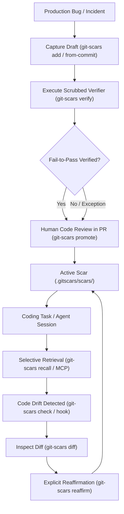

# GitScars (`git-scars`)

[](https://pkg.go.dev/github.com/Pavanspoojary/scars)
[](LICENSE)
[](https://goreportcard.com/report/github.com/Pavanspoojary/scars)
[](https://github.com/Pavanspoojary/scars/actions/workflows/ci.yml)

> **A Git-native failure memory and regression guardrail system for software engineers and AI coding assistants.**

GitScars captures lessons learned from production incidents, subtle concurrency bugs, and breaking regressions as versioned, human-reviewable Markdown documents anchored directly to repository files, symbols, error signatures, and dependency versions.

When developers edit code or coding agents (Claude Code, Cursor, Antigravity, Windsurf) tackle tasks, GitScars deterministically retrieves only the relevant failure memories before mistakes repeat.

---

## Table of Contents

- [The Problem](#the-problem)
- [Architecture & Comparison](#architecture--comparison)
- [Why Not Just Scoped Rules?](#why-not-just-scoped-rules-cursorrules--claudemd)
- [How It Works](#how-it-works)
- [Installation & Build](#installation--build)
- [Quickstart Workflow](#quickstart-workflow)
  - [Automated Regression Harvesting (`harvest`)](#16-automated-historical-regression-mining-git-scars-harvest)
  - [Portable Memory Bundles (`bundle`)](#17-portable-memory-bundles-git-scars-bundle)
  - [Self-Healing Execution Loop (`heal`)](#18-self-healing-execution-loop-git-scars-heal)
  - [CI/CD & SARIF Annotations (`check --format sarif`)](#19-cicd--github-code-scanning-sarif-git-scars-check---format-sarif)
  - [Multi-Language AST Freshness](#20-multi-language-ast-aware-freshness-go-python-typescript)
- [File Format & Schema](#file-format--schema)
- [AI Agent Integration & MCP Server](#ai-agent-integration--mcp-server)
- [Dependency Manifest & Lockfile Anchors](#dependency-manifest--lockfile-anchors)
- [CLI Command Reference](#cli-command-reference)
- [Security, Threat Model & Privacy](#security-threat-model--privacy)
- [Documentation & ADRs](#documentation--adrs)
- [Contributing](#contributing)

---

## The Problem

Repository knowledge frequently disappears into old commits, closed pull requests, Slack threads, and transient agent conversation transcripts. As repositories expand:

- **Monolithic Instruction Files (`AGENTS.md`, `CLAUDE.md`)** suffer from prompt bloat, attention dilution ("lost in the middle"), and cannot bind rules to specific file versions or symbol anchors.
- **Vector Memory & RAG** introduce semantic hallucinations, noisy false-positive retrieval (see [VibeMemBench arXiv:2609.23570](https://arxiv.org/abs/2609.23570)), and vulnerability to indirect prompt injection ([MemSecBench arXiv:2607.27080](https://arxiv.org/abs/2607.27080)).
- **Silent Code Drift**: Code changes over time. When files change, lessons written months ago become stale or invalid, but flat files provide no way to detect staleness.

---

## Architecture & Comparison

| Capability | Monolithic (`AGENTS.md`) | Glob-Scoped (`.cursor/rules`) | Vector Memory (RAG) | **GitScars (`git-scars`)** |
| :--- | :--- | :--- | :--- | :--- |
| **Prompt Strategy** | Unconditional full dump | Directory glob pattern match | Semantic similarity search | Selective multi-signal anchor match |
| **Average Prompt Tokens** | `871` tokens (all rules) | `187` tokens avg (directory rules) | Dynamic retrieval | **`133` tokens avg (-28.9% vs Scoped)** |
| **Drift Detection** | None (silent obsolescence) | None (silent failure on move) | None (unanchored) | **Deterministic SHA-256 & AST symbol hashing** |
| **Verification Gate** | Unverified text assertions | Unverified text assertions | None | **Scrubbed fail-to-pass test execution** |
| **Human Governance** | Ad-hoc edits | Ad-hoc edits | None | **Promotion gate (`git-scars promote`)** |
| **Host Security Boundary** | Static text | Static text | Cloud API / embeddings | **Host `argv` execution (`cleanEnv()`) + trust-hash** |
| **Runtime Dependencies** | Offline text | Offline text | Remote embeddings / DB | **Zero dependencies (pure Go single binary)** |

*For scenario-by-scenario modeled token measurements and architectural case walkthroughs, see [SCENARIO_ANALYSIS.md](SCENARIO_ANALYSIS.md).*

---

## Why Not Just Scoped Rules (`.cursor/rules` / `CLAUDE.md`)?

Glob-scoped rules (such as Cursor `.cursor/rules/*.mdc` or nested directory `CLAUDE.md` files) provide path-scoping out of the box. Why is GitScars necessary when path-scoping already exists?

In our scenario walkthrough across 10 production regression patterns ([SCENARIO_ANALYSIS.md](SCENARIO_ANALYSIS.md)), scoped rules fail in three critical production scenarios:

### 1. The Refactored Anchor (Silent Failure)
- **Failure**: When code is moved or refactored (e.g., `services/billing/calc.py` becomes `core/pricing/calc.py`), glob rules silently stop firing. If obsolete files remain, they fire on dead code. Scoped rules have **0% drift detection**.
- **GitScars Defense**: Anchors track both file SHA and symbol AST hashes. If anchors move, `git-scars check` fails in CI with exit code 2. Teams maintain an unbroken chain of memory using `git-scars supersede`.

### 2. The Toxic Unverified Claim
- **Failure**: A developer or AI agent writes an untested rule (e.g., `"Set DisableKeepAlives = true on http.Transport"`). In production, disabling keep-alives forces TLS renegotiation on every connection, crashing API latency and exhausting local ports. Scoped rules accept any markdown without execution proof.
- **GitScars Defense**: Scars cannot transition to `active` without a runnable fail-to-pass verifier. Claims must be proven against code before entering prompt memory.

### 3. Prompt Inflation & Rule Contradiction
- **Failure**: In shared directories (`pkg/**` or `services/**`), glob-scoped rules dump every rule into the prompt simultaneously. In our benchmark, editing a client file pulled 4 unrelated concurrency rules (334 tokens of attention dilution).
- **GitScars Defense**: Token-budgeted injection (`git-scars inject --budget 400`) scores multi-signal anchors (symbols, error signatures, dependency versions) and injects only the exact relevant guardrail with structured `<dont>` and `<do>` instructions.

---

## How It Works



---

## Installation & Build

Requires Go 1.22+:

```bash
# Clone the repository
git clone https://github.com/Pavanspoojary/scars.git
cd scars

# Build the single standalone static binary
go build -o git-scars ./cmd/git-scars
```

Optionally install `git-scars` into your system `$PATH`:
```bash
sudo mv git-scars /usr/local/bin/
```
Once installed, Git automatically discovers it: you can run either `git-scars <command>` or `git scars <command>`.

---

## Quickstart Workflow

### 1. Initialize GitScars
```bash
git-scars init
```
Creates `.gitscars/scars/` for versioned lessons and `.gitscars/.local/` (automatically gitignored) for derived local state (indexes, trusted verifier hashes, feedback).

### 2. Capture a Failure Lesson
Create a new draft using the interactive terminal wizard:
```bash
git-scars add -i
```

Or pass flags directly:
```bash
git-scars add \
  --title "Nil pointer dereference in auth context" \
  --lesson "Always use comma-ok idiom when reading user profile from request context" \
  --files "pkg/auth/context.go"
```

Or capture automatically from an existing fix commit without requiring an LLM:
```bash
git-scars add from-commit 8a1b3f9
```
*Prefills changed files, parent base commit, fix commit, and inferred test commands into a new draft.*

### 3. Record Verification Evidence
Execute the verifier safely against the codebase:
```bash
git-scars verify nil-pointer-dereference-8a1b3f --interactive
```
Computes deterministic command hashes, scrubs the environment, redacts secrets, and tests the worktree.

The command exits `1` when verification does not produce a passable result, so CI pipelines can gate on it. Recorded evidence never promotes a scar on its own: a human reviewer must still run `git-scars promote`.

### 4. Review and Promote
Human review is required before a Scar can become active:
```bash
git-scars promote nil-pointer-dereference-8a1b3f \
  --status active \
  --reviewer "alice" \
  --rationale "Reviewed test reproduction in PR #42"
```

### 5. Selective Retrieval
Retrieve relevant lessons during coding tasks:
```bash
# By target file
git-scars recall --files pkg/auth/context.go

# Diff-aware retrieval (against a branch or commit)
git-scars recall --diff origin/main

# Failure-aware retrieval from failing test stderr
go test ./... 2>&1 | git-scars recall --stdin

# Machine-readable JSON output for coding agents
git-scars recall --files pkg/auth/context.go --json
```

### 6. Token-Budgeted Agent Prompt Injection
Generate an ultra-dense, token-budget-capped guardrail block for AI coding agents before file editing:
```bash
# Generate compact XML block capped to 300 estimated tokens
git-scars inject --files "pkg/auth/context.go" --budget 300

# Generate Markdown guardrails for prompt templates
git-scars inject --files "pkg/auth/context.go" --budget 200 --format markdown
```

### 7. Autonomous Instruction File Sync
Automatically synchronize active failure memories into AI agent instruction files (`AGENTS.md`, `CLAUDE.md`, `.cursorrules`, `.windsurfrules`):
```bash
# Auto-discover and update existing agent instruction files
git-scars sync

# Or explicitly target specific instruction files
git-scars sync --targets AGENTS.md,CLAUDE.md
```
*Manages a deterministic markdown table between `<!-- GIT-SCARS:START -->` and `<!-- GIT-SCARS:END -->` markers, preserving all external prompt rules.*

### 8. Instant Failure & Test Triage
Diagnose raw compiler errors, panic stack traces, or test failures directly against recorded regression wisdom across multiple languages:
- **Go**: `panic:`, `fatal error: all goroutines asleep - deadlock`, `--- FAIL:`, race detector warnings, and runtime file/line locations.
- **Python**: `Traceback (most recent call last)`, `File "...", line N, in func`, `AssertionError`.
- **JavaScript & TypeScript**: V8 stack traces `at func (file:line:col)`, `Error:`, `TypeError`.
- **Rust**: `thread '...' panicked at '...'`, source locations `src/file.rs:N`.
- **Generic / Runners**: Memory faults (`Segmentation fault`), test framework failures, and race reports.

```bash
# Pipe failing test output directly to triage
go test ./... 2>&1 | git-scars triage

# Or diagnose a specific error signature
git-scars triage --error "fatal error: all goroutines are asleep - deadlock"

# Machine-readable JSON for agent automated healing loops
git-scars triage --error "panic: nil pointer" --json
```

### 9. Read-Only Freshness Check in CI
Add to your CI workflow to ensure no active Scars have stale anchors:
```bash
git-scars check
```
**Stable Exit Codes**:
- `0`: All Scars valid and current.
- `1`: Invalid format or invariant violation. Records that fail to parse or that break a lifecycle invariant are reported, never skipped.
- `2`: Stale anchor detected (code modified since baseline, requires reaffirmation).
- `3`: Operational error.

An active scar that claims `fail_to_pass` verification must record a `command_hash` derived from its own `argv`. A record whose hash does not match its command is rejected as an invariant violation and is never injected into an agent prompt.

### 10. Git Pre-Commit Hook Guardrail
Install the Git pre-commit hook to catch stale active scars before staging and committing:
```bash
# Install hook into .git/hooks/pre-commit
git-scars hook install

# Inspect hook status
git-scars hook status

# Uninstall hook
git-scars hook uninstall
```

### 11. Inspect Drift & Reaffirm
When `git-scars check` or pre-commit hooks report modified anchors, inspect the exact unified diff before reaffirming:
```bash
# View unified line diff against recorded anchor baseline
git-scars diff map-write-crash-391945

# Reaffirm anchor baseline after human review
git-scars reaffirm map-write-crash-391945 \
  --reviewer "alice" \
  --rationale "Verified logic holds after refactoring exporter package"
```

### 12. Repository Health & Metrics
Inspect overall repository scar metrics, monitored anchors, and recorded feedback:
```bash
# Human-readable summary
git-scars stats

# Machine-readable JSON metrics
git-scars stats --json
```

### 13. Run Full Diagnostics & Automated Repair
Audit Git worktree health, scar file loadability, schema validity, invariants, anchor drift, and hook readiness:
```bash
# Interactive diagnostic checklist
git-scars doctor

# Machine-readable JSON report for CI pipelines
git-scars doctor --json

# Automatically repair recoverable cache, local directory, and hook configurations
git-scars doctor --fix
```

### 14. Lifecycle Contradiction & Supersession
Manage evolution of failure memories as codebase architectures and best practices evolve:
```bash
# Contradict an outdated scar with documented rationale and conflict reference
git-scars contradict scar-001 --by scar-005 --rationale "Worker pool refactored to context cancellation"

# Supersede an obsolete scar by a successor scar
git-scars supersede scar-001 --by scar-005
```

### 15. Near-Duplicate Scar Detection
Inspect active repository scars for semantic and lexical duplication using token-level Jaccard similarity:
```bash
# Dry-run near-duplicate audit (default threshold: 0.85)
git-scars dedupe --dry-run

# Custom similarity threshold and machine-readable JSON
git-scars dedupe --min 0.75 --json
```

### 16. Automated Historical Regression Mining (`git-scars harvest`)
Bootstrap repository memory by walking Git history to identify past bug-fixing commits and generating draft scars with built-in quality filtering to eliminate draft noise:
- **Diff-Size Cap (`--max-files 5`)**: Automatically ignores commits touching `> 5` files to avoid noisy reformatting, mass migrations, and large multi-package refactors.
- **Co-Located Test Requirement**: Skips commits without co-located test updates by default to guarantee verified test behavior (override with `--allow-untested`).
- **Confidence Scoring (`--min-confidence 7`)**: Computes a 1-10 quality confidence score based on message clarity, test co-location, and scope; drafts scoring below 7 are rejected to prevent human review fatigue.

```bash
# Preview high-confidence candidate bug fixes in recent commit history (dry run)
git-scars harvest --max 50 --dry-run

# Automatically generate quality-filtered draft scars for review and promotion
git-scars harvest --max 100 --min-confidence 7

# Inspect findings as structured JSON
git-scars harvest --json
```

### 17. Portable Memory Bundles (`git-scars bundle`)
Share, export, and import curated sets of verified failure memories across teams and services without sharing entire Git histories:
```bash
# Export active scars into a portable verified JSON memory bundle
git-scars bundle export --out ./shared-scars.json

# Export with severity filtering
git-scars bundle export --severity critical --out ./critical-scars.json

# Import memory bundle into repository as reviewable drafts (with optional ID prefix)
git-scars bundle import ./shared-scars.json --prefix org-
```
*Note: All imported scars are ingested as unreviewed drafts (`status: unreviewed`) to guarantee local verifier execution and team code review before activation.*

### 18. Self-Healing Execution Loop (`git-scars heal`)
Run test suites or build commands under automated surveillance. When failures occur, `heal` intercepts output, matches relevant regression scars, and generates structured remediation guidance:
```bash
# Run tests under self-healing observation
git-scars heal -- go test -race ./...

# Machine-readable output for autonomous agent loops
git-scars heal --json -- npm test
```

### 19. CI/CD & GitHub Code Scanning SARIF (`git-scars check --format sarif`)
Integrate GitScars directly into pull request checks and security dashboards using the OASIS SARIF 2.1.0 standard:
```bash
# Scaffold production-ready GitHub Actions workflow (.github/workflows/git-scars.yml)
git-scars init --ci github

# Emit SARIF report for GitHub Code Scanning annotations
git-scars check --format sarif > git-scars.sarif

# Pre-edit enforcement blocking check in SARIF format
git-scars enforce --files "pkg/auth.go" --format sarif
```

### 20. Multi-Language AST-Aware Freshness (Go, Python, TypeScript)
GitScars includes built-in syntactic symbol hashing across multiple languages to eliminate reaffirm fatigue:
- **Go**: Full AST symbol declaration extraction via `go/parser` and `go/ast`.
- **Python**: Function (`def`, `async def`) and class (`class`) definition hashing.
- **TypeScript & JavaScript**: Functions, classes, interfaces, types, and exported symbols.

When anchor source files are modified:
- If anchored symbols remain syntactically identical (e.g. comments, whitespace, imports, or unrelated helper functions changed), freshness remains **`current`**, eliminating rubber-stamp reaffirmations on hot files.
- If anchored symbol declarations are altered or removed, freshness transitions to **`changed`** (stale), signaling the need for review and reaffirmation.

---

## File Format & Schema

Each Scar is stored as a single, human-readable, Git-diffable Markdown file in `.gitscars/scars/<slug>-<shortid>.md` with strict YAML frontmatter:

```markdown
---
schema_version: "1"
id: "map-write-crash-391945"
slug: "concurrent-map-write-in-telemetry-exporter"
title: "Concurrent map write in telemetry exporter"
lesson: "Metrics map must be protected by sync.RWMutex during RecordMetric calls."
severity: "high"
fix_hint: "Wrap map mutations in mu.Lock() or replace with sync.Map"
bad_pattern: "m[key] = val"
good_pattern: "mu.Lock(); m[key] = val; mu.Unlock()"
applicability: "Telemetry exporters handling concurrent metrics emissions."
anchors:
  files:
    - "pkg/telemetry/exporter.go"
  symbols:
    - "RecordMetric"
  commands:
    - "go test -race ./pkg/telemetry/..."
  error_signatures:
    - "fatal error: concurrent map writes"
verifier:
  result: "fail_to_pass"
  argv:
    - "go"
    - "test"
    - "-race"
    - "./pkg/telemetry/..."
  command_hash: "2d4b1ee683d6be106b1633c27fedb692d3f757a5aa049397e28ef1cbd6d52736"
baseline:
  recorded_at: "2026-10-11T08:00:00Z"
  pkg/telemetry/exporter.go: "a3b98f12c4..."
review:
  status: "approved"
  reviewer: "bob"
  date: "2026-10-11T08:05:00Z"
  rationale: "Reproduced with race detector in PR #104"
lifecycle:
  state: "active"
---

### Symptom & Root Cause
Under heavy concurrent load, multiple goroutines called RecordMetric simultaneously without synchronization.

### Footgun / Guardrail
Replaced raw map with sync.Map or guarded reads and writes with sync.RWMutex.
```

---

## Anchor Semantics

A guardrail is only useful while its anchors still describe the code it protects. `git-scars lint` and `git-scars check` therefore verify anchor semantics rather than trusting them:

| Rule | Severity | Meaning |
| :--- | :--- | :--- |
| `anchor_symbol_missing` | `WARNING` | The anchored symbol no longer exists in any anchored file. |
| `bad_pattern_present` | `ERROR` | The recorded footgun is still present in the anchored code. |
| `good_pattern_absent` | `WARNING` | The recorded fix cannot be found, so the anchor likely no longer covers the fixed code. |
| `missing_severity` | `WARNING` | An active guardrail does not declare a severity, so it cannot be compared against a blocking threshold. |

`bad_pattern` and `good_pattern` must be **literal snippets of code**, so that presence and absence can be checked deterministically:

- `good_pattern` is a snippet of the fixed code and must be present in an anchored file.
- `bad_pattern` is a snippet of the footgun and must be absent from every anchored file.

A pseudo-code pattern such as `m[key] = val` cannot be verified and will always be reported as absent.

---

## AI Agent Integration & MCP Server

### 1. Model Context Protocol (MCP) Server

GitScars provides a built-in stdio Model Context Protocol (MCP) server for native integration with coding assistants:

The server reports the current release version in its `initialize` response, so client-visible metadata stays aligned with the CLI banner and SARIF tool metadata.

```bash
git-scars mcp
```

The MCP server exposes rich two-way tools and resources for AI coding agents:

#### Standard Tools:
- `list_scars`: List all repository scars with their lifecycle and dynamic freshness status.
- `get_scar`: Retrieve full frontmatter, anchors, verifier results, and markdown body by scar ID.
- `recall_scars`: Deterministically retrieve matching scars for target files, symbols, error messages, and commands.
- `inject_guardrails`: Generate an ultra-compact, token-budget-capped prompt guardrail block for specific files.
- `triage_error`: Diagnose raw compiler errors, panic stack traces, or test outputs against recorded scars.
- `draft_scar`: Autonomously record a new failure memory draft into repository Git memory.

#### Composite Tools (Single-Roundtrip Workflow):
- `pre_edit_check`: Pre-edit blocking guardrail check. Inspects target files and symbols before file modifications and returns blocking scars with actionable do/don't patterns and verification commands.
- `plan_task`: Combines selective recall and token-budget prompt injection into a single roundtrip for task planning.
- `post_failure_learn`: Multi-language failure triage and diagnostic learning in a single roundtrip, returning prevention lessons for test errors or stack traces.

#### Resources:
- `scar://<id>`: Read individual scar frontmatter and prevention lessons directly as MCP resources.
- `scars://active`: Read the auto-generated markdown summary table of active repository guardrails.

#### Client Configuration

##### Claude Desktop (`claude_desktop_config.json`) / Cursor (`.cursor/mcp.json`) / Antigravity
```json
{
  "mcpServers": {
    "git-scars": {
      "command": "git-scars",
      "args": ["mcp"]
    }
  }
}
```

##### Zed (`settings.json`)
```json
{
  "context_servers": [
    {
      "id": "git-scars",
      "command": {
        "path": "git-scars",
        "args": ["mcp"]
      }
    }
  ]
}
```

### 2. CLI JSON Recall (`reposcars.recall.v1`)

Agents can also invoke the CLI directly:
```bash
git scars recall --files "$MODIFIED_FILES" --json
```

Output:
```json
{
  "schema_version": "reposcars.recall.v1",
  "timestamp": "2026-10-11T08:00:00Z",
  "query": { "files": ["pkg/telemetry/exporter.go"], "threshold": 3, "top_k": 3 },
  "count": 1,
  "results": [
    {
      "id": "map-write-crash-391945",
      "title": "Concurrent map write in telemetry exporter",
      "lesson": "Metrics map must be protected by sync.RWMutex during RecordMetric calls.",
      "score": 5,
      "confidence": 0.26,
      "freshness": "current",
      "matches": ["file(+5)"],
      "explanation": "file(+5)",
      "anchors": { "files": ["pkg/telemetry/exporter.go"] }
    }
  ]
}
```

### 3. Pre-Edit Guardrail Enforcement (`git-scars enforce`)

Prevent AI coding agents and developers from re-introducing known regressions before files are modified:

```bash
# Check files before editing; returns exit code 2 if a high-severity guardrail matches
git-scars enforce --files "pkg/worker.go" --fail-on high
```

Exit Codes:
- `0`: Clean (no blocking guardrails detected).
- `2`: Blocked (blocking guardrail detected; outputs actionable `<dont>`, `<do>`, and verification instructions to stderr).

A guardrail that does not declare a severity is treated as `high`, so an uncalibrated guardrail is never silently downgraded below the blocking threshold.

Machine JSON Output:
```bash
git-scars enforce --files "pkg/worker.go" --json
```

### 4. Zero-Friction Agent Onboarding (`git-scars init --agent`)

Configure coding assistants with a single setup command:
```bash
git-scars init --agent claude,cursor,zed,antigravity
```
Automatically scaffolds `.claude/mcp.json`, `.cursor/rules/git-scars.mdc`, `.zed/settings.json`, and `.gemini/config/rules/git-scars.md`.

---

## Dependency Manifest & Lockfile Anchors

GitScars automatically inspects repository dependency manifests and lockfiles to anchor lessons to exact package versions without manual configuration:

- **Go**: Direct module dependencies and versions from `go.mod`.
- **Node.js**: Package dependencies and versions from `package-lock.json` (v1, v2, and v3).
- **Rust**: Package versions from `Cargo.lock`.
- **Python**: Dependencies and versions from `poetry.lock` and `requirements.txt`.

When dependencies are upgraded or downgraded, Scars anchored to vulnerable or breaking versions automatically trigger match signals during recall.

Dependency anchors are authored with the `name@version` form:

```bash
git-scars add \
  --title "Redis pipeline breaks on client upgrade" \
  --lesson "Upgrade the redis client only after reviewing the pipeline change" \
  --files "pkg/cache/redis.go" \
  --deps "github.com/redis/go-redis/v9@9.5.1"
```

They are persisted in the scar frontmatter and re-read on every subsequent load, so the anchor survives verification, reaffirmation, and synchronization cycles:

```yaml
anchors:
  dependencies:
    - name: "github.com/redis/go-redis/v9"
      version: "9.5.1"
```

---

## CLI Command Reference

| Command | Arguments | Description |
| :--- | :--- | :--- |
| `init` | `[--agent <targets>, --ci <target>]` | Initialize `.gitscars/` repository, agent configs, and CI workflows (`--ci github`) |
| `add` | `[-i], [--title, --lesson, --files, --deps]` | Create a new scar draft (interactive wizard or flags) |
| `add from-commit` | `<sha>` | Automatically prefill a draft from a Git commit diff |
| `list` | none | List recorded scars with lifecycle, review, and freshness |
| `show` | `<id>` | Display full metadata, anchors, and body of a scar |
| `diff` | `<id>` | Inspect unified line diff of anchor files against baseline |
| `promote` | `<id> --status active` | Promote a scar to active state (enforces review & verifier invariants) |
| `verify` | `<id> [--interactive]` | Safely execute verifier in scrubbed env and record evidence (exit `1` when verification does not pass) |
| `reaffirm` | `<id> --reviewer --rationale` | Reaffirm a scar after anchor code drift |
| `contradict` | `<id> --by <new-id> --rationale` | Transition scar to contradicted state with conflict reference |
| `supersede` | `<id> --by <new-id>` | Supersede an obsolete scar by a successor scar |
| `retire` | `<id>` | Retire a scar that is no longer applicable |
| `recall` | `--files`, `--diff`, `--stdin`, `--json` | Retrieve relevant scars with deterministic multi-signal scoring |
| `enforce` | `--files`, `[--fail-on, --format, --staged, --json]` | Pre-edit blocking guardrail check (`--format sarif`, exit `0` clean, exit `2` blocked) |
| `inject` | `[--files, --task, --budget, --format]` | Generate token-budgeted prompt guardrails with `<dont>` and `<do>` patterns |
| `sync` | `[--targets <files>]` | Synchronize active scars into AGENTS.md / CLAUDE.md |
| `triage` | `[--error <text>, --json]` | Diagnose test failures and panic traces against recorded scars |
| `dedupe` | `[--min <sim>, --dry-run, --json]` | Detect duplicate and near-duplicate scars (token Jaccard similarity) |
| `harvest` | `[--max <n>, --since <ref>, --dry-run, --json]` | Automatically mine bug-fixing commits from Git history into scar drafts |
| `bundle` | `export [options], import <file> [options]` | Export and import portable, verified memory bundles (`gitscars.bundle.v1`) |
| `heal` | `[--json] -- <command...>` | Run test command, intercept failures, and automatically triage regressions |
| `check` | `[--diff <ref>, --format sarif]` | Read-only verification of scar freshness and invariants (`--format sarif`) |
| `lint` | none | Security, schema, and anchor-semantics audit (checks traversal, injections, unloadable files, anchor drift, noisy scars) |
| `doctor` | `[--json, --fix]` | Run repository diagnostics and automatically repair caches/hooks |
| `stats` | `[--json]` | Display repository metrics, monitored anchors, and feedback stats |
| `index` | none | Rebuild `.gitscars/.local/index.json` fast cache |
| `hook` | `install`, `status`, `uninstall` | Manage Git pre-commit hook guardrail |
| `mcp` | none | Run read-only stdio Model Context Protocol (MCP) server |
| `feedback` | `<id> --rating --notes` | Record retrieval utility feedback (`helpful`, `irrelevant`, `incorrect`) |
| `version` | none | Print `git-scars` version |

---

## Security, Threat Model & Privacy

### Scrubbed Environment, Not Container Isolation
`git-scars verify` executes verifiers directly on the host machine. While environment variables are scrubbed (`cleanEnv()`) and shell interpolation is prevented via direct `exec.Command` argv arrays, **verifiers run with the permissions of the host process and have full filesystem and network access**. Scrubbing is not OS container isolation.

### Threat Model & Trust Boundaries
1. **Never Auto-Run Untrusted Verifiers**: Verifiers from external pull requests or untrusted memory bundles must be reviewed before execution.
2. **Deterministic Command Trust-Hash**: Verification commands are hashed (`sha256`) and recorded in `verifier.command_hash`. Invariant checks reject verifiers whose hashes do not match.
3. **Mandatory Human Review Gate**: Scars cannot become `active` without explicit human sign-off (`git-scars promote --reviewer`). Untrusted drafts cannot inject guardrails into agent prompts.
4. **Secret Redaction**: Automated regex scrubbing redacts Bearer tokens, private keys, API keys, and passwords before recording execution outputs.
5. **Zero Cloud Telemetry**: All feedback, index caches, and command trust lists are stored locally in gitignored `.gitscars/.local/`. No data leaves your machine.

---

## Documentation & ADRs

- [SCENARIO_ANALYSIS.md](SCENARIO_ANALYSIS.md): Design estimates and illustrative scenario walkthrough across 10 regression patterns comparing prompt token footprints and architectural failure modes.
- [EVAL_PLAN.md](EVAL_PLAN.md): Preregistered benchmark evaluation plan, scoring baseline weights, and power calculations.
- [PRIOR_ART.md](PRIOR_ART.md): Primary-source comparative analysis (`Daily-Nerd/Scar`, `fscars`, `gitmem`, arXiv:2609.23570).
- [DECISIONS.md](DECISIONS.md): Architecture Decision Records (ADR-0001 through ADR-0014).

---

## Contributing

Contributions are welcome! Please read [CONTRIBUTING.md](CONTRIBUTING.md) and [AGENTS.md](AGENTS.md) for repository standards, code quality gates, and branching rules.

---

## License

Apache License 2.0. See [LICENSE](LICENSE) for details.
